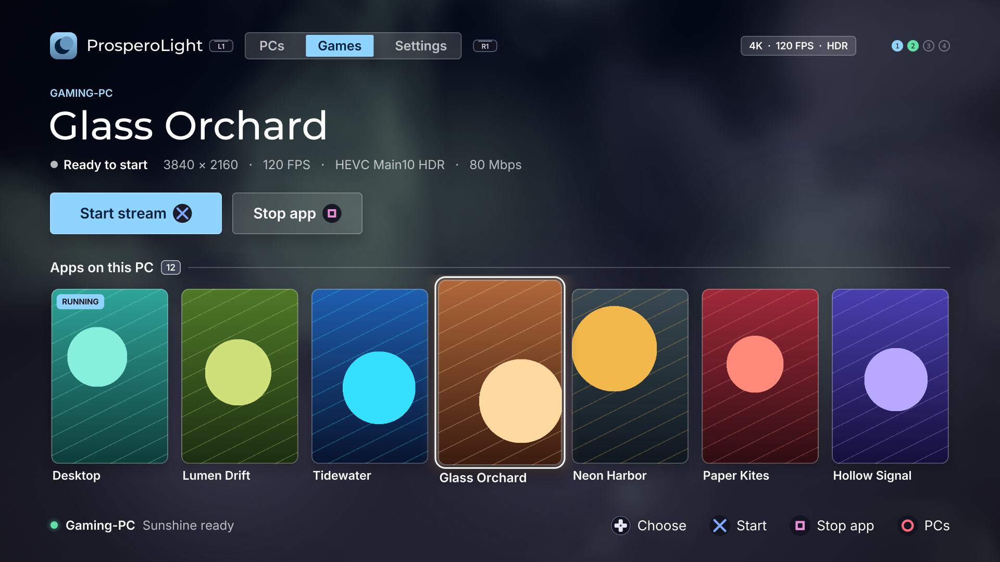

<p align="center">
  
</p>

<h1 align="center">ProsperoLight</h1>

<p align="center">
  <strong>Moonlight game streaming, natively on PlayStation 5.</strong><br>
  Stream games and your desktop from a Sunshine-compatible PC to a homebrew-enabled PS5.
</p>

<p align="center">
  <a href="https://github.com/LedyBacer/ProsperoLight/releases"></a>
  
  <a href="LICENSE"></a>
</br>
<a href="https://discord.gg/xermTyfngt"></a>
</p>

<p align="center">
  
</p>

Features and fixes in the `main` branch may not be available in the [latest published release](https://github.com/LedyBacer/ProsperoLight/releases). Check the [changelog](CHANGELOG.md) and the release notes before updating.

## Features

- **Native PS5 video:** hardware-accelerated H.264 and HEVC (including HDR10) through VideoDec2 and AGC, with 1080p, 1440p and 4K stream options.
- **High-refresh streaming:** 30, 60, 90 and 120 FPS presets, plus Custom 30–120 FPS. Actual performance depends on codec, bitrate and hardware.
- **Frame pacing and VRR:** Unpaced, fixed-refresh Paced and adaptive Paced+VRR modes. Current source builds include Low Latency, Balanced and Smooth VRR timing profiles and low-FPS frame repetition.
- **PyroWave:** an optional Vulkan GPU decoder with SDR/HDR and 4:2:0/4:4:4 profiles, requiring a compatible Vibepollo/Vibeshine host.
- **Controllers and input:** up to four DualSense controllers, supported haptics/adaptive triggers, USB keyboard and mouse, plus on-screen keyboard and controller-driven mouse mode.
- **Audio:** selectable stereo or 5.1-channel Opus playback.
- **A console-first launcher:** automatic LAN discovery, multiple saved PCs, application artwork, persistent settings, and a UI available in 31 languages.
- **Wake an offline PC:** after pairing with Sunshine and refreshing once while the PC is awake, its MAC is remembered; an offline PC with that MAC offers an explicit IPv4 **Wake PC** action. Packet emission and the PC coming online are reported separately.
- **Updates and diagnostics:** in-app update support for compatible folder installations, performance overlay, and optional timing/log capture.


## Get started

1. **Prepare your PS5.** You need a console with a compatible homebrew environment and title loader already configured. ProsperoLight does not install or provide an exploit.
2. **Install ProsperoLight.** Get `PPSA99002.zip` from [Releases](https://github.com/LedyBacer/ProsperoLight/releases), extract it, and copy the complete `PPSA99002/` folder to `/data/homebrew/`. Close the app before replacing an older installation; refresh your homebrew loader's title registration.
3. **Start Sunshine** (or a compatible host) on your PC. A wired local network is strongly recommended.
4. **Pair and play.** Open ProsperoLight, select a discovered PC or add its address, and enter the pairing PIN in your host's web interface. Open **Games** and choose an app or Desktop.

Press **Touchpad + L1** to end the stream and return to the launcher. Pairings and settings normally remain in `/data/prosperolight` when updating the app.

**[Full user guide →](docs/USER_GUIDE.md)** — installation, pairing, updates, controllers, settings and saved data.

## Wake a saved PC

After a saved PC has answered Sunshine once while awake, ProsperoLight remembers its valid MAC. When that PC later appears offline, the primary PC button becomes **Wake PC**. Confirming it sends IPv4 Wake-on-LAN packets and then checks the PC every second for up to 30 seconds.

A successful send means **wake packet emitted**, not **PC woke**. The PC must already support Wake-on-LAN in firmware/BIOS/UEFI and its NIC/OS, remain reachable on the same IPv4 broadcast domain, and accept Sunshine's base port or a standard WOL port. See [Wake a saved PC](docs/USER_GUIDE.md#wake-a-saved-pc) and [troubleshooting](docs/TROUBLESHOOTING.md#wake-pc-is-missing-or-the-pc-does-not-wake).

## Controls


| During streaming        | Action                            |
| ----------------------- | --------------------------------- |
| **Touchpad + L1**       | Return to ProsperoLight           |
| **Touchpad + R1**       | Toggle performance overlay        |
| **Touchpad + Square**   | Toggle controller/mouse mode      |
| **Touchpad + Triangle** | Open/close the on-screen keyboard |


Touchpad means pressing the touchpad **until it clicks**. See the [complete controls reference](docs/USER_GUIDE.md#controls), including the host Back/Guide shortcuts and multi-controller behavior.

## Video quality and compatibility


### Bitrate limits

**H.264/HEVC decoding and PyroWave have different performance characteristics.** In measured native 4K HEVC sessions, bitrates above roughly 80 Mbps at 120 FPS can exceed the PS5 decoder's real-time budget. Increasing bitrate is not always an improvement. PyroWave has different host and network requirements.

### VRR and frame timing

VRR support depends on the console, firmware, TV and actual output mode; a successful VideoOut API call does **not** prove physical HDMI VRR or a particular latency improvement. For a starting point, try a wired network, native HEVC, and conservative bitrate before experimenting with higher refresh rates.

**[Performance and video guide →](docs/PERFORMANCE_GUIDE.md)** — codec selection, measured bitrate limits, pacing modes and VRR caveats.

## Documentation


| For                | Start here                                                                                                                                             |
| ------------------ | ------------------------------------------------------------------------------------------------------------------------------------------------------ |
| **Players**        | [User guide](docs/USER_GUIDE.md) · [Performance guide](docs/PERFORMANCE_GUIDE.md) · [Troubleshooting](docs/TROUBLESHOOTING.md)                         |
| **Advanced users** | [PyroWave](docs/PYROWAVE.md) · [DualSense](docs/DUALSENSE.md) · [Frame pacing tests](docs/PACING_TEST_MATRIX.md) · [Home-screen forwarders](docs/FORWARDER.md)                                       |
| **Developers**     | [Getting started](docs/GETTING_STARTED.md) · [Architecture](docs/ARCHITECTURE.md) · [Testing](docs/TESTING.md) · [Deployment](docs/DEPLOYMENT.md)      |
| **Maintainers**    | [Configuration](docs/CONFIGURATION.md) · [Validation](docs/VALIDATION.md) · [Release packaging](docs/RELEASE_ZIP.md) · [Contributing](CONTRIBUTING.md) |
| **Project**        | [Changelog](CHANGELOG.md) · [Roadmap / ideas](docs/ROADMAP.md) · [Third-party notices](THIRD_PARTY_NOTICES.md)                                         |


## Build from source

See [Getting started](docs/GETTING_STARTED.md) for Linux/WSL prerequisites and reproducible dependencies. Once set up:

```bash
git submodule update --init --recursive
make doctor
make check
```

The build produces a complete `dist/PPSA99002/` app directory. For the safe FTP deployment workflow, see [Deployment](docs/DEPLOYMENT.md).

## Support and contributions

Found a bug? [Open an issue](https://github.com/LedyBacer/ProsperoLight/issues) with your PS5 firmware, host version, codec/settings and reproduction steps. For stream problems, enable **Diagnostic logs** and attach relevant logs after reviewing [Troubleshooting](docs/TROUBLESHOOTING.md). Logs can contain local host addresses and app names; review them before sharing.

Contributions and testing across different TVs, firmwares and network setups are welcome. See [CONTRIBUTING.md](CONTRIBUTING.md).

> [!IMPORTANT]
> This is an independent homebrew project, not an official Sony, Moonlight or Sunshine product. It requires a compatible homebrew-enabled console and includes no exploits, proprietary Sony SDK, firmware, keys or game assets. Use at your own risk and only with hardware and content you are entitled to use.


## Credits

**Original creator:** [BlackBearReloaded](https://github.com/blackbearreloaded).

**Current maintainer (since October 2026):** [LedyBacer](https://github.com/LedyBacer).

Special thanks to BlackBearReloaded for creating ProsperoLight, building its native PS5 foundation, and entrusting the project's continued development to a new maintainer. The original author's contributions remain credited throughout the repository.

Thanks to ProsperoLight contributors, including Nikita Dybov, KrisEnigma, and everyone who has contributed code, testing, and feedback.

Built with the [PS5 Payload SDK](https://github.com/ps5-payload-dev/sdk) by John Törnblom (ps5-payload-dev).
Third-party components, authors and licenses are listed in
[THIRD_PARTY_NOTICES.md](THIRD_PARTY_NOTICES.md).

## License

Copyright © 2026 BlackBearReloaded and respective contributors. Licensed under GPL-3.0-or-later; see [LICENSE](LICENSE). The repository transfer does not alter existing copyright or license notices. Third-party components keep their own licenses. Binary releases are built from the tagged source in this repository.

## Disclaimer

- **No affiliation.** This is an independent homebrew project. It is not
affiliated with, endorsed by, or sponsored by Sony Interactive Entertainment.
"PlayStation", "PS5" and related marks are trademarks of Sony Interactive
Entertainment Inc. This project is not affiliated with or endorsed by the Moonlight or Sunshine projects.
- **No proprietary material.** No Sony SDK, firmware, encryption keys or
decrypted system modules are included.
- **No warranty.** This project is provided "as is", without warranty of any
kind, to the extent permitted by law. See sections 15 and 16 of the GPL.
- **Use at your own risk.** Running homebrew requires a modified console, which
may void its warranty, breach the platform's terms of service, or cause data
loss.
- **Legal use only.** Use it only with hardware, accounts and content you own.
This project does not support or enable piracy.


## AI assistance

This project was developed with AI assistance from OpenAI and/or Anthropic tools.

