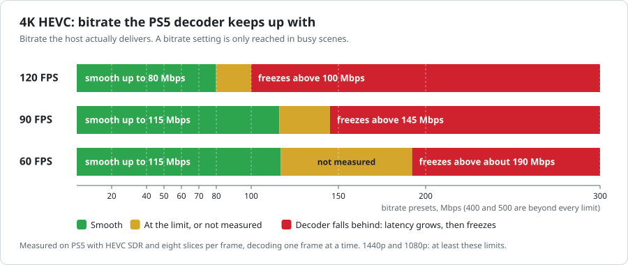

# Video quality and performance

[← Back to README](../README.md) · [User guide](USER_GUIDE.md) · [Frame pacing test matrix](PACING_TEST_MATRIX.md)

The streaming bitrate is only one part of picture quality. The PS5 must receive, decode and present each frame before its display deadline. Codec, resolution, FPS, encoder behavior, network stability and output mode all matter.

## Which codec should I use?

| Codec | Best starting point | Important limitations |
| --- | --- | --- |
| **HEVC (native)** | General-purpose streaming, especially 1440p/4K and HDR10 | At high resolution and FPS, VideoDec2 decoding can become the bottleneck even on a fast LAN. |
| **H.264 (native)** | Compatibility with conventional Sunshine hosts | 4K, particularly 90/120 FPS, can exceed the decoder's throughput budget. |
| **PyroWave (Vulkan)** | High-bitrate experimentation with a compatible Vibepollo/Vibeshine host | Requires explicitly advertised PyroWave profiles, disabled host compression and substantial reliable LAN bandwidth. |

PyroWave is an optional GPU codec, **not** an HEVC/H.264 quality preset. Its bitrate scale is different, and it is not available from an ordinary Sunshine host unless that host supports it. See [PyroWave](PYROWAVE.md) for supported formats, setup and protocol details.

## Native HEVC bitrate limits

> [!WARNING]
> **More bitrate does not necessarily mean better streaming.** In measured 4K HEVC sessions, too much compressed data caused decoder backlog, growing delay and periodic freezes. Use the performance overlay to distinguish this from packet loss.

| Native 4K HEVC source | Smooth in measured tests up to | Freezes observed above | Conservative recommendation |
| --- | --- | --- | --- |
| **120 FPS** | 80 Mbps | 100 Mbps | **80 Mbps or less** |
| **90 FPS** | 115 Mbps | 145 Mbps | **100 Mbps or less** |
| **60 FPS** | 115 Mbps | ~190 Mbps *(extrapolated)* | **100 Mbps or less**; 150 Mbps is unverified |

These are **observations from one PS5 test setup**, not universal hardware specifications. They were measured with HEVC SDR and eight slices per frame, decoding one frame at a time (Classic). Other encoders, GOP settings, firmware, HDR, decoder pipelines and frame-size distributions can behave differently. Lower resolutions are not independently characterized by the table.

The setting in ProsperoLight is the **requested bitrate ceiling**. Sunshine may deliver much less in an easy scene. The original measurements found that a nominal 80 Mbps configuration sometimes delivered only about 24 Mbps; an upper setting of 300 Mbps could produce about 160 Mbps. Diagnose from actual stream traffic and decode metrics, not the slider alone.

The original analysis modeled a 4K HEVC decode cost of approximately 3.7 ms plus 45 µs per KiB of compressed frame data in one measured regime (and another regime above approximately 105 KiB). At 120 FPS, the source period is about 8.33 ms. This explains why extremely large compressed frames can saturate decoding despite ample GPU/display or LAN bandwidth. See [Performance Round 4](PERFORMANCE_ROUND_4.md) for the source measurements and [the plotting script](../tools/plot-bitrate-limits.py).

For native **H.264 4K60**, the UI warns around 80 Mbps. Native **H.264 4K90/120** may be decode-limited even at lower bitrates: use HEVC or reduce resolution rather than assuming that frame pacing will solve throughput limits.

## PyroWave network guidance

PyroWave offers a higher bitrate control range (up to 1000 Mbps). In documented local 4K120 SDR/HDR tests, 500–600 Mbps worked on one wired setup, while 700–800 Mbps sometimes encountered network loss. These observations are **not general quality or latency guarantees**. Start conservatively and monitor received packets, stale pictures, GPU decode time and flip errors. Avoid treating high bandwidth as useful when the source quality does not benefit.

## Frame pacing modes

| Mode | Purpose | Behavior |
| --- | --- | --- |
| **Unpaced** | Minimum intentional client buffering | Present the newest ready picture without adding a source-cadence wait; V-Sync still affects output. |
| **Paced** | Regular timing on fixed-refresh output | Fit source cadence to 60 Hz for requested FPS ≤60 or high-refresh output above 60, including fractional placement such as 90 FPS on fixed 120 Hz. |
| **Paced+VRR** | Adaptive timing on variable-refresh output | Use the incoming source clock and a shared real-frame/repeat scheduler, adapting to changes in actual captured FPS. Falls back to fixed-output pacing when VRR is unavailable. |

**Low Latency / Balanced / Smooth** are timing profiles for active Paced+VRR output. Their *maximum* adaptive intentional reserve is **0 / 8 / 16 ms** respectively; this is not a fixed delay added to every frame. Actual physical panel scanout and input-to-photon latency are not measured by the application.

### Variable FPS and frame repetition

On a static desktop, the host may send fewer frames than the configured 60/90/120 FPS. In active VRR mode, ProsperoLight can repeat the last decoded image so the display receives a viable scanout cadence; it does **not** invent new animation frames. Fresh frames take priority over optional repeats, and the scheduler adapts when motion resumes.

The following are illustrative **steady-state scheduler targets** derived from the current source-code policy, not guaranteed TV readings:

| Incoming source rate | Possible repeat factor | Scheduler target |
| ---: | ---: | ---: |
| ~16 FPS (sparse capture) | 5× | ~80 Hz |
| 30 FPS | 3× | ~90 Hz |
| 35 FPS | 3× | ~105 Hz |
| 40 FPS | 2× | ~80 Hz |
| 50 FPS | 2× | ~100 Hz |
| 51 FPS | 2× | ~102 Hz |
| 60 FPS | 1× | ~60 Hz |
| 90 FPS | 1× | ~90 Hz |
| 120 FPS | 1× | Limited by the nominal ~119.88 Hz high-refresh mode |

Actual transitions involve hysteresis, source timestamp fitting, repeat admission rules and hardware behavior. A brief source-FPS dip does not immediately force a new factor. VRR API state alone does not prove physical HDMI refresh. The same TV may also show brightness fluctuations when its actual scanout interval varies.

Implementation and measurement details: [Configuration](CONFIGURATION.md#source-clock-frame-pacing), [frame-pacing measurements](frame-pacing-measurements.md) and the [repeatable test matrix](PACING_TEST_MATRIX.md).

## Practical tuning sequence

1. First get a stable **1080p60 or 1440p60 HEVC** stream with a moderate bitrate and a wired LAN.
2. Use the performance overlay (**Touchpad + R1**) to watch received/displayed FPS, decode time/load, decoder backlog and network loss separately.
3. Increase resolution or FPS **one at a time**, and reduce bitrate if the decoder stops keeping up. Avoid H.264 4K120 as a baseline pacing test because decoder load can obscure presentation behavior.
4. If you have a suitable TV, test **Paced+VRR** and compare low-motion, static and return-to-motion scenes. Use Balanced first; select Low Latency when responsiveness matters most, or Smooth if repeatable client-side readiness jitter is visible.
5. When something stutters, record whether it was caused by network packet loss, decode pressure, dropped/late pictures, or TV refresh variation. Do not treat the VideoOut software counter as a physical HDMI timestamp.

For reproducible comparisons, follow the [frame-pacing test matrix](PACING_TEST_MATRIX.md) rather than relying solely on subjective comparisons from unrelated games.

VideoDec2 startup is stream-aware. The old `EXPERIMENTAL_HOST_DPB` switch no
longer selects a fixed four/six-slot allocation. Inspect stream-required DPB,
configured native capacity, allocation bytes and lifecycle counters separately.
See [decoder lifecycle validation](design/VIDEODEC2_LIFECYCLE.md) for Test Lab
profiles and first-ready/decoded/presented software-clock interpretation.
